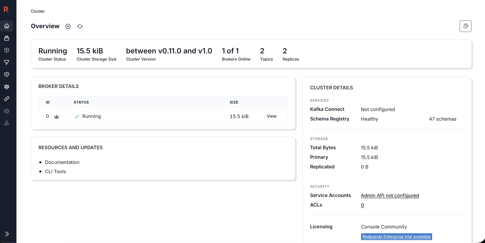
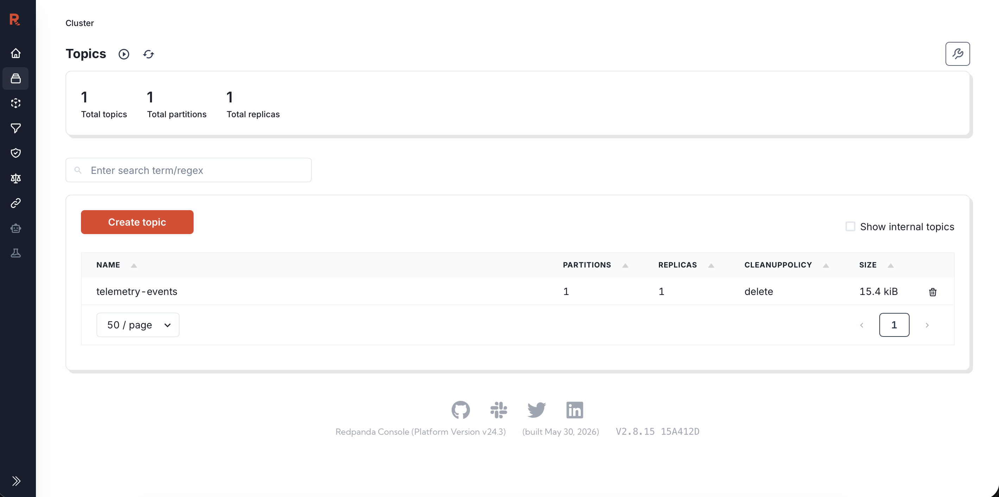
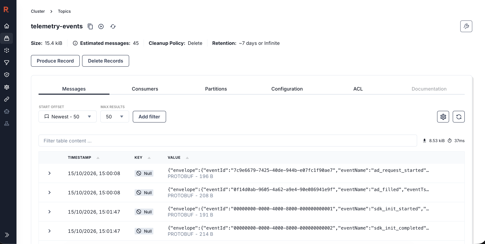
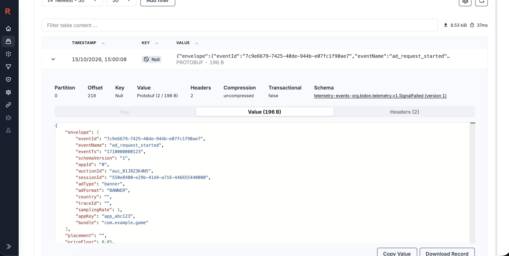
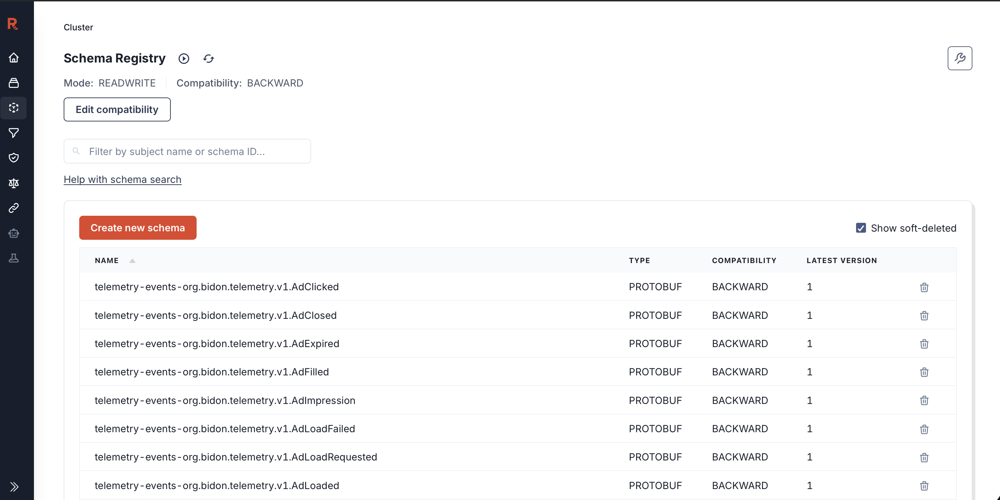

# Exploring Redpanda Console and VictoriaMetrics

Draft for the local `just compose` stack. Console is the event log: one record per thing that happened. VictoriaMetrics (vmui) is the counters and histograms scraped from the APIs. An auction id lives on the event. It is not a metric label.

| | URL |
| --- | --- |
| Redpanda Console | http://localhost:8080 |
| Schema Registry (also linked from Console) | http://localhost:18081 |
| vmui | http://localhost:8428/vmui |
| Scrape target health | http://localhost:8428/targets |
| sdkapi metrics, before they are scraped | http://localhost:1324/metrics |
| Telemetry ingest metrics | http://localhost:1326/metrics |

VictoriaMetrics scrapes both `/metrics` endpoints every 15 seconds and keeps 7 days (`docker/telemetry/victoriametrics/scrape.yml`). A counter moves on the raw `/metrics` page immediately. vmui shows it on the next scrape.

To put data on the bus, use `sdk.http`:

- `POST http://localhost:1324/v2/auction/{ad_type}` writes the server auction and DSP events.
- A later show / win / loss writes `ad_impression` and the notice events, and also writes the older JSON notice topic.
- `POST http://localhost:1326/v2/telemetry` writes client events onto the same telemetry topic and updates the client histograms.

## What you are looking at

Three topics. Only one of them is the new catalog.

| Topic | Who writes it | Payload | When it has rows |
| --- | --- | --- | --- |
| `telemetry-events` | sdkapi, and `bidon-telemetry` for client batches | Protobuf, one message type per event, Confluent-framed | After an auction, a show, a notice, or `POST /v2/telemetry` |
| `notification-events` | sdkapi, when it calls a DSP notice URL | JSON | After a win, loss, billing, or timeout notice |
| `ad-events` | sdkapi | JSON, the older auction log (includes device ids and raw bid bodies) | Off in local compose. `KAFKA_PRODUCE_AD_EVENTS` is `false`, so this topic is often missing |

`telemetry-events` is the topic to explore. The other two are the streams that already existed. A show still produces both a protobuf `ad_impression` and, for the notice HTTP call, a JSON row on `notification-events`.

## Redpanda Console

Open **Topics**, then `telemetry-events`, then **Messages**. Set the start offset to the oldest offset (or a timestamp just before you sent the request) and raise the limit. A three-DSP auction with no show is eight records: one request, three sends, three responses, one completion. A below-floor bid adds a `dsp_response_rejected`. Show and notices add more.

The five screenshots below are one local session after the `sdk.http` telemetry requests: client events on `telemetry-events`. `valid_request.json` was produced at 15:00:08 (`ad_request_started`, `ad_filled`). The catalogue fixture, one of each client event, was produced at 15:01:47 (`sdk_init_started` starts at event id `…0001`).

### Cluster overview



This is the Console home page. **Running** and broker 0 healthy means the local Redpanda container is up. **15.5 KiB** is the whole cluster, so almost nothing has been written yet.

**2 topics** and **2 replicas** are `telemetry-events` plus Redpanda’s internal `_schemas` topic (one replica each). The Topics page hides internal topics unless **Show internal topics** is checked, which is why the next screenshot lists a single topic. **Kafka Connect: Not configured** is expected. This stack does not sink the topic anywhere. **Schema Registry: Healthy, 47 schemas** means the registry is up. That count is registered subjects, one per message type written so far. **ACLs 0** and the admin API unset is local dev with no auth.

The version line **between v0.11.0 and v1.0** is Console failing to map this dev broker’s API versions onto one version string. The broker is the image in `docker-compose.dev.yml`.

### Topics



Click the topic icon in the left rail. The only user topic is `telemetry-events`: 1 partition, 1 replica, cleanup policy `delete`, about 15 KiB. `notification-events` and `ad-events` are absent until something produces them. Ad events stay off unless `KAFKA_PRODUCE_AD_EVENTS=true`.

Open `telemetry-events`. Do not use **Produce record** or **Delete records** while poking around. Those write or wipe the topic.

### Messages



**Messages** is the log. The header on this capture: **15.4 KiB**, about **45** messages, cleanup **delete**, retention left at the dev default (**~7 days or infinite**).

**Start offset: Newest − 50** and **max results 50** loads the latest page. **Add filter** is the JavaScript filter described below. The box under it only filters rows already loaded into the table.

Read the table like this:

| Column | What this capture shows |
| --- | --- |
| Timestamp | When the record was produced. 15:00:08 is the small sample batch. 15:01:47 is the catalogue batch. This is not `eventTs` |
| Key | Null. Telemetry records are not keyed |
| Value | A one-line preview of the decoded protobuf. `eventName` in that preview is the catalog event. **PROTOBUF · N B** means Console decoded it. A binary blob means the Confluent frame was missing and Console could not decode |

The four visible rows are `ad_request_started`, `ad_filled`, `sdk_init_started`, and `sdk_init_completed`. The rest of the catalogue is further down the same page. The `…0001` and `…0002` event ids are the catalogue fixture. The two UUIDs at 15:00:08 are `valid_request.json`.

That same `valid_request.json` also sends a `client_auction_duration_seconds` sample. It does not appear here. Metric samples are applied to `/metrics` and scraped into vmui. Only `events` become topic records.

### One expanded record



The chevron expands a row. This one is offset 218 on partition 0, 196 bytes, uncompressed, not transactional, key null, **2 headers**.

**Value** is protobuf decoded as JSON, camelCase. The fields in this shot:

| JSON | Why it looks like that |
| --- | --- |
| `eventName: ad_request_started` | The catalog name. This is the field to trust |
| `eventId` | The id from the sample batch |
| `eventTs: "1710000000123"` | The client’s timestamp, 9 Mar 2024 16:00:00.123 UTC. The table timestamp is 15 Oct 2026 because that is when the fixture was posted |
| `schemaVersion: 1` | Current catalog major. int32, so it is a JSON number |
| `appId: "0"` | Client ingest does not know the numeric app id. int64 fields are JSON strings |
| `appKey`, `bundle` | Copied from the batch’s `app` object (`app_abc123`, `com.example.game`) |
| `auctionId`, `sessionId`, `adType`, `adFormat` | Copied from the event. `sessionId` is the batch session when the event omits one |
| `country`, `traceId` | Empty. Ingest clears both |
| `samplingRate: 1` | Nothing is sampled |
| `placement: ""` | Proto3 leaves unset strings as `""`. This sample did not send a placement. `priceFloor` further down is `0.05`, which the sample did send |

**Headers (2)** are `event_name` and `protobuf_message`. Switch to that tab to filter or to confirm the type when the value did not decode.

The **Schema** link on this row says `telemetry-events-org.bidon.telemetry.v1.SignalFailed`, and the body is `ad_request_started`. Those are different messages. Every subject is the same `events.proto` file, so the registry stores them under one schema id. Console looks that id up and prints a single subject name for it. The message index inside the record is what selects `ad_request_started`, which is why `placement` and `priceFloor` are present. `SignalFailed` has neither. Treat `envelope.eventName` as the event type. The link still opens the shared proto file, which contains every message.

### Schema Registry



The Schema Registry item in the left rail. **READWRITE** and default compatibility **BACKWARD** match how the producers register.

Each row is one message type, not one event. The name is `telemetry-events-org.bidon.telemetry.v1.<Message>`, type **PROTOBUF**, compatibility **BACKWARD**, latest version **1**. The filter box searches that name. The list is alphabetical, so this shot is the `Ad*` types (`AdClicked`, `AdClosed`, `AdExpired`, `AdFilled`, `AdImpression`, …). `AuctionCompleted` and `DspResponseReceived` are further down, once sdkapi has registered them. Version 1 with no newer version means the proto file has not been registered again since the first successful write.

Each record has two headers and a decoded value.

| Header | Example | Use it for |
| --- | --- | --- |
| `event_name` | `dsp_response_received` | Which catalog event this row is |
| `protobuf_message` | `org.bidon.telemetry.v1.DspResponseReceived` | Which protobuf type Console used to decode it |

Console prints protobuf as JSON with camelCase names, so the proto field `auction_id` appears as `auctionId`, and `event_name` inside the envelope appears as `eventName`. Enums appear as their proto names (`OUTCOME_BID`, `ERROR_CODE_NO_ADS_FOUND`), not the short metric labels.

Every event has an `envelope`:

| Field in the UI | Meaning |
| --- | --- |
| `eventId` | Unique id for this row |
| `eventName` | Same string as the `event_name` header |
| `eventTs` | Unix milliseconds |
| `schemaVersion` | `1` |
| `appId` | Server app id. Set on sdkapi events. Client ingest writes `0` and fills `appKey` and `bundle` instead |
| `auctionId` | The id on the auction request. Join key, together with `appId` |
| `sessionId` | SDK session |
| `adType`, `adFormat`, `country` | From the auction request when sdkapi emitted the row |
| `dspId`, `demandSource` | Filled on DSP and notice rows |
| `samplingRate` | `1`. Nothing is sampled yet |
| `traceId` | Reserved for the per-auction trace. Local auctions leave it empty |

The first records after sdkapi boots can be opaque bytes. Registration of each schema is async, and until that type has a schema id the producer sends raw protobuf. Those rows have the same headers, and Console cannot expand the value. Send the auction again, or read a later offset. Subjects show up under **Schema Registry**, named `telemetry-events-org.bidon.telemetry.v1.<Message>`.

### Filtering

On the Messages page, **Add filter → JavaScript Filter**. The function returns `true` to keep the record. Headers arrive as bytes, so decode them. This works even when the value is still raw protobuf.

```javascript
function header(name) {
  const raw = headers[name];
  if (!raw) return "";
  return String.fromCharCode(...new Uint8Array(raw));
}

return header("event_name") === "dsp_response_received";
```

One auction, all of its rows:

```javascript
function header(name) {
  const raw = headers[name];
  if (!raw) return "";
  return String.fromCharCode(...new Uint8Array(raw));
}

return value.envelope && value.envelope.auctionId === "PASTE_AUCTION_ID";
```

A DSP that timed out:

```javascript
return value.outcome === "OUTCOME_TIMEOUT";
```

A below-floor reject:

```javascript
return value.rejectReason === "REJECT_REASON_BELOW_FLOOR";
```

On `notification-events` the payload is already JSON, so the field names stay snake_case:

```javascript
return value.event_type === "NURL";
```

### Server events on `telemetry-events`

sdkapi emits these. `POST /v2/telemetry` refuses the five auction and DSP names. It accepts the impression and notice names, but the rows you see after a real auction come from sdkapi.

**Bidding round.** One auction emits the first, then one send and one response per DSP that was actually called, then the completion. `participantCount` on the completion equals that DSP count. Amazon is one response per request, not one per slot.

| `event_name` | When | Fields past the envelope |
| --- | --- | --- |
| `auction_request_received` | `/v2/auction` is accepted, before the effective floor replaces the SDK floor | `requestedPriceFloor` — the floor the SDK sent |
| `dsp_request_sent` | Immediately before the adapter HTTP call | `dsp`, `scope` (`SCOPE_BIDDING_ROUND`), `timeoutBudgetMs` (0 for Amazon) |
| `dsp_response_received` | Adapter returned, once per send | `dsp`, `outcome`, `httpStatus`, `latencyMs` (send to return), `price` when it bid, `nbr` when the response had one, `creativeId`, `crtype` |
| `dsp_response_rejected` | A bid existed and `price` did not beat the effective floor | `dsp`, `price`, `priceFloor`, `rejectReason` (`REJECT_REASON_BELOW_FLOOR` only, today) |
| `auction_completed` | Bidding round finished, including failures | `winnerDsp`, `price`, `priceFloor` (effective floor, not the SDK floor), `participantCount`, `totalLatencyMs`, `errorCode` |

`outcome` on the protobuf row:

| UI value | What happened |
| --- | --- |
| `OUTCOME_TIMEOUT` | The call hit its deadline |
| `OUTCOME_HTTP_ERROR` | HTTP 4xx/5xx, or a transport error with status 0 |
| `OUTCOME_MALFORMED` | A body came back and could not be parsed |
| `OUTCOME_BID` | A bid |
| `OUTCOME_NOBID` | A clean no-bid (204 or an empty seat) |

Timeout is chosen before the HTTP and parse checks. `errorCode` on `auction_completed` is `ERROR_CODE_NO_ADS_FOUND`, `ERROR_CODE_INVALID_AUCTION_KEY`, or `ERROR_CODE_ERROR`. Empty means the round finished without an auction error. `winnerDsp` is empty when nothing cleared the effective floor.

**Show and notices.** `/v2/show` writes `ad_impression`. If the show request already carried a client `ad_impression` with an `eventId`, that row is published as-is and sdkapi does not write a second one. Otherwise sdkapi synthesizes one (`dsp`, `price`; `renderDurationMs` and `omEnabled` stay at the zero value).

| `event_name` | When | Fields past the envelope |
| --- | --- | --- |
| `ad_impression` | Show | `dsp`, `price`, and on a client row `renderDurationMs`, `omEnabled` |
| `win_notice_sent` | nurl attempt, after retries | `dsp`, `clearingPrice`, `success`, `httpStatus`, `retryCount`, `latencyMs` |
| `billing_notice_sent` | burl attempt | `dsp`, `billablePrice`, `success`, `httpStatus`, `retryCount`, `latencyMs` |
| `loss_notice_sent` | lurl attempt, and also a TimeoutURL | `dsp`, `lossReasonCode`, `winningPrice`, `success`, `httpStatus`, `retryCount`, `latencyMs` |
| `notice_delivery_failed` | Same attempt, only when `success` is false | `dsp`, `noticeType`, `httpStatus`, `attempts`, `latencyMs`, `errorCode` |

`noticeType` is `NOTICE_TYPE_WIN`, `NOTICE_TYPE_BILLING`, `NOTICE_TYPE_LOSS`, or `NOTICE_TYPE_TIMEOUT`. TimeoutURL is stored as a loss event with `NOTICE_TYPE_TIMEOUT`, so the event name stays `loss_notice_sent`. `errorCode` on the failure event is `http_4xx`, `http_5xx`, or `transport`. HTTP 2xx is success. 4xx is terminal. 5xx is retried, then recorded with `success: false`.

### Client events on the same topic

`POST /v2/telemetry` on port 1326 publishes every other catalog name. Filter with the same `event_name` header. The envelope on these rows has `appKey` and `bundle`, `appId` 0, and no `traceId`. A batch that names a server auction event, or a metric name that is not on the allow-list, is dropped and counted on `ingest_total` (see vmui below). Fields missing from the proto are dropped without a counter. The event is still accepted and the HTTP response is 202.

| Area | `event_name` |
| --- | --- |
| Init | `sdk_init_started`, `sdk_init_completed`, `sdk_init_failed`, `adapter_init_result`, `config_fetch_result` |
| Tokens | `adapter_token_requested`, `adapter_token_result`, `token_collection_completed` |
| Client auction | `ad_request_started`, `auction_requested`, `auction_response_received`, `ad_filled`, `auction_failed`, `auction_no_demand` |
| Load | `ad_load_requested`, `adm_parse_result`, `renderer_selected`, `ad_loaded`, `ad_load_failed`, `ad_expired` |
| Show | `ad_show_requested`, `ad_impression`, `ad_show_failed`, `ad_viewable`, `ad_clicked`, `ad_closed`, `ad_reward_granted` |
| Render | `webview_error`, `render_crashed`, `sdk_crashed` |
| Video | `video_start`, `video_q1`, `video_midpoint`, `video_q3`, `video_complete`, `video_skipped`, `video_error` |
| MAX adapter | `adapter_load_budget_exceeded`, `no_fill_returned_to_max`, `signal_requested`, `signal_provided`, `signal_failed`, `signal_timeout_suspected` |

`sdk.http` has a “one of each client event” request that posts the catalogue fixture. After it, filter `telemetry-events` on any name in the table.

### The older JSON topics

`notification-events` is one JSON object per notice HTTP call. `event_type` is `NURL`, `BURL`, `LURL`, or `TimeoutURL`. Useful fields: `auction_id`, `demand_id`, `ecpm`, `url`, `error`, `loss_reason`. This is the call sdkapi made. The protobuf `*_notice_sent` row is the same attempt, with status, retries, and latency.

`ad-events` uses `event_type` values such as `config`, `auction_request`, `bid_request`, `bid`, `stats_request`, `demand_request`, `client_bid`, `win`, `loss`, `show`, `click`, `reward`. Local compose does not produce it. Those rows carry advertising ids, IP, and raw DSP bodies, which is why the new topic exists beside them.

## VictoriaMetrics

Open http://localhost:8428/vmui. The **Query** tab takes PromQL. Set the time range to the last 15 or 30 minutes, run the query, and switch between the table and the graph. **Explore → Explore cardinality** lists metric names and which labels they have. http://localhost:8428/targets should show `bidon-sdkapi` and `bidon-telemetry` as up.

Two jobs:

| `job` | Process | What landed there |
| --- | --- | --- |
| `bidon-sdkapi` | sdkapi `:1324` | Auction, DSP, notice, and impression metrics, plus ordinary HTTP metrics |
| `bidon-telemetry` | ingest `:1326` | Client ingest results and the three client histograms |

Metric labels are low-cardinality on purpose. There is no `auction_id`, `app_id`, or `event_id`. To see one auction, use Console. vmui answers “how many” and “how slow” across auctions.

Counters only go up. `increase(...[15m])` is the count over the window. `rate(...[5m])` is per second. A histogram query uses the `_bucket` series.

### Is the scrape alive?

```promql
up
```

```promql
sum by (url, code) (increase(sdkapi_requests_total[15m]))
```

`sdkapi_requests_total` and `sdkapi_request_duration_seconds` exist as soon as sdkapi has served traffic. The telemetry series below appear after the first event of that kind.

### Auctions

`result` is `ok` or `error`. `error` means `Run` returned an error (`no ads`, bad auction key, or anything else). A round that finishes with no winner and no error is still `ok`; the empty `winnerDsp` is on the event, not on this counter.

```promql
sum by (result) (increase(auction_completed_total[15m]))
```

### DSP outcomes

`outcome` is the short label: `bid`, `nobid`, `timeout`, `http_error`, `malformed`. That is the same decision as `OUTCOME_*` on `dsp_response_received`, without the prefix.

```promql
sum by (dsp, outcome) (increase(dsp_response_total[15m]))
```

Timeouts for one DSP, as a share of its responses:

```promql
sum by (dsp) (rate(dsp_response_total{outcome="timeout"}[5m]))
/
sum by (dsp) (rate(dsp_response_total[5m]))
```

### DSP latency

`dsp_request_duration_seconds` is send-to-return, labeled only by `dsp`. Buckets are 50ms, 100ms, 250ms, 500ms, 1s, 2s, 4s, 8s. A latency above 8s sits in the `+Inf` bucket.

```promql
histogram_quantile(0.95, sum by (le, dsp) (rate(dsp_request_duration_seconds_bucket[5m])))
```

Swap `0.95` for `0.50` for a median. The graph is empty until that DSP has a few samples inside the window.

### Dropped telemetry

This should stay flat. A non-zero `reason` means a catalog event never reached `telemetry-events`.

```promql
sum by (reason) (increase(telemetry_dropped_total[15m]))
```

| `reason` | Meaning |
| --- | --- |
| `invalid` | Missing event name or envelope |
| `marshal` | Protobuf encode failed |
| `buffer_full` | The producer buffer was full. Counted, not logged on every row |
| `produce_error` | The broker rejected the record |

### Notices and impressions

`notice_delivery_total` counts HTTP attempts. `type` is `nurl`, `burl`, `lurl`, or `timeout` (TimeoutURL). `result` is `2xx`, `4xx`, `5xx`, or `timeout` (transport failure, status 0). The `timeout` label means two different things on the two axes: as `type` it is a TimeoutURL, as `result` it is a failed connection.

```promql
sum by (type, result) (increase(notice_delivery_total[15m]))
```

```promql
increase(ad_impression_total[15m])
```

`ad_impression_total` counts rows emitted, synthesized or client. It has no labels.

### Client ingest

These series are on `job="bidon-telemetry"`. They stay absent until something calls `POST /v2/telemetry`.

```promql
sum by (result) (increase(ingest_total[15m]))
```

| `result` | Meaning |
| --- | --- |
| `accepted` | Event produced, or a metric sample applied |
| `dropped_name` | Unknown `event_name`, or the JSON did not match that message. Includes the five server auction and DSP names |
| `dropped_metric` | Metric name not allow-listed, not a histogram, or an unexpected label key |
| `buffer_full` | Ingest queue was full |
| `produce_error` | Produce failed |

The only client histograms, and the only labels they accept:

| Metric | Labels |
| --- | --- |
| `client_auction_duration_seconds` | `ad_type` |
| `client_token_collection_duration_seconds` | `ad_type` |
| `client_ad_load_duration_seconds` | `ad_type`, `result` |

```promql
histogram_quantile(0.95, sum by (le, ad_type) (rate(client_auction_duration_seconds_bucket[15m])))
```

```promql
histogram_quantile(0.95, sum by (le, ad_type, result) (rate(client_ad_load_duration_seconds_bucket[15m])))
```

Anything else in the batch’s `metrics` array increments `dropped_metric` and does not create a series.

## One auction, both UIs

1. Send a banner auction from `sdk.http`.
2. In Console, open `telemetry-events` from the newest offset and read `envelope.auctionId` off `auction_request_received`.
3. Filter on that `auctionId`. You should see the request, a send and a response per DSP, any below-floor reject, and `auction_completed`. `latencyMs` on each response is that DSP only. `totalLatencyMs` on the completion is the whole round.
4. Wait for a scrape, then in vmui run `sum by (dsp, outcome) (increase(dsp_response_total[15m]))`. The outcomes should match the `outcome` fields you just read, summed across every auction in the window, not just this one.
5. Call show. Console gains `ad_impression`, then `billing_notice_sent` and the other notice rows. `notification-events` gains a JSON row per notice with the same `auction_id`. vmui’s `notice_delivery_total` and `ad_impression_total` move on the next scrape.

If Console has the events and vmui does not, check http://localhost:8428/targets and http://localhost:1324/metrics. If `/metrics` has the counter and vmui does not, the scrape is behind or the time range does not cover it. If `/metrics` does not have it either, that code path did not run.
